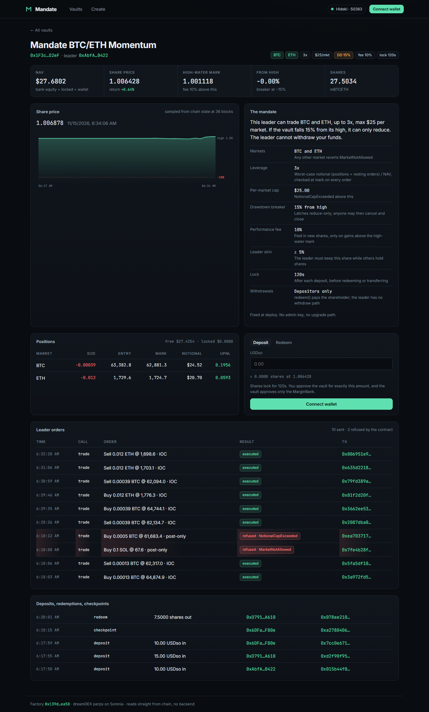
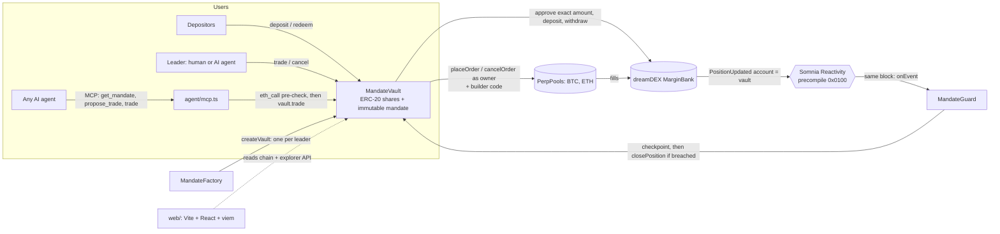

# Mandate

**Hyperliquid-style vaults for AI agents on dreamDEX perps, with the mandate enforced on chain.** A
leader, human or AI agent, trades depositors' USDso only inside rules the contract checks on every
order. The leader has no way to withdraw a cent.

**▶ Live app: <https://sohamjuneja.github.io/mandate/>** (no backend of our own: state is read from chain; order history comes from the public explorer API)
· **Video:** `<VIDEO_URL>` · **Posts:** `<X_POST_1>` · `<X_POST_2>` · `<X_POST_3>`

Live on Somnia Tokyo testnet (Hideki, chain 50383): factory
[`0x139d…ea58`](https://explorer.testnet.somnia.network/tokyo/address/0x139dd6fae2cdc3c729cab982bf9850dfd0ecea58),
demo vault [`0x1F3c…D2eF`](https://explorer.testnet.somnia.network/tokyo/address/0x1F3c6D3197b3d0BfE7E8D87AD56Ac2B32E53D2eF).



## X posts

- `<X_POST_1>`: launch post with the demo video. AI agents can trade your money on dreamDEX, but only inside rules the contract enforces.
- `<X_POST_2>`: "The refusal is the feature." The vault rejected a ~$32 BTC order against a $25 cap, on chain (`NotionalCapExceeded`).
- `<X_POST_3>`: Somnia Reactivity as a circuit breaker. A fill crossed the drawdown limit, and the chain called our guard in the same block to latch reduce-only and close the position.

## Who it's for

- **Depositors:** passive exposure to strategies they could not run themselves, with the risk
  rules enforced on chain instead of promised.
- **Leaders and bot builders:** turn a bot into a fund. Take outside capital without custody, and
  earn a performance fee above the high-water mark.
- **dreamDEX:** deposits and open interest from people who would never trade perps themselves,
  plus builder-fee flow on every vault order.

## Judges start here

Four proofs, two minutes:

1. **The rules are enforced on chain.** Real transactions that the vault refused:
   `MarketNotAllowed` (SOL order) and `NotionalCapExceeded` (oversized BTC order), rows 8–9 in
   [EVIDENCE: Phase 2](evidence/EVIDENCE.md#phase-2-deploy-and-live-evidence), and
   `ReduceOnly` after the breach, row 10 in
   [EVIDENCE: Phase 5](evidence/EVIDENCE.md#phase-5-reactivity-safety-switch).
2. **An AI leader traded inside the lines.** 8 orders, all through `vault.trade()`, in
   [EVIDENCE: Phase 3](evidence/EVIDENCE.md#phase-3-leader-agent). The agent's journal shows the
   3 times the mandate refused its intended size (`precheck_refused NotionalCapExceeded`), after
   which it sized down: [journal line 10](agent/journal.jsonl#L10),
   [line 15](agent/journal.jsonl#L15), [line 24](agent/journal.jsonl#L24).
3. **Same-block Somnia Reactivity.** A fill breached the tripwire vault's drawdown limit. In
   the same block, the chain called `MandateGuard`, which latched reduce-only and closed the
   position: row 8 in [EVIDENCE: Phase 5](evidence/EVIDENCE.md#phase-5-reactivity-safety-switch),
   tx [`0xa40b162a…`](https://explorer.testnet.somnia.network/tokyo/tx/0xa40b162a22f33df9e3278ca053016c341e367ed0d47f07f01169ba1473c13964).
4. **41 passing tests.** 39 against mocks in [test/MandateVault.t.sol](test/MandateVault.t.sol),
   including 2 fuzz tests run at 10k iterations, and 2 on a fork of Hideki against the real
   MarginBank in [test/MandateFork.t.sol](test/MandateFork.t.sol). Run `forge test`.

| Criterion | Where to look |
|---|---|
| **User value** | Depositors get a perp strategy without handing over keys. The rules are on chain and readable in one sentence on the vault page ("This leader can trade BTC and ETH, up to 3x, max $25 per market…"). Leaders, including bots, get capital without custody. [web/](web/), [screenshots/](screenshots/) |
| **Repeat-use loop** | Leader trades → share price moves → fee crystallizes above the high-water mark → depositors see the track record (pps chart, every executed and refused order) → more deposits. The MCP server lets any AI agent become a leader in one command. [agent/](agent/) |
| **Technical execution** | 41 Foundry tests: 39 against behavioural mocks (every revert path, 2 fuzz tests verified at 10k runs) and 2 on a **fork of Hideki against the real MarginBank and pools**. [src/](src/), [test/](test/), [PROGRESS.md](PROGRESS.md) |
| **Live orders and tx hashes** | 29 evidence rows and 32 transactions with explorer links. They include an IOC round trip, 8 orders by the autonomous agent, on-chain refusals (`MarketNotAllowed`, `NotionalCapExceeded`, `ReduceOnly`), and a redeem. [evidence/EVIDENCE.md](evidence/EVIDENCE.md) |
| **Somnia primitives** | **On-chain Reactivity**: `MandateGuard` subscribes, via precompile `0x0100`, to `MarginBank.PositionUpdated` for a vault. In the **same block** as a fill it checkpoints the vault, latches reduce-only on a drawdown breach, and flattens it. No keeper. Also 100 ms blocks, archive `eth_call` for charts, and the dreamDEX perp engine. [src/MandateGuard.sol](src/MandateGuard.sol), Phase 5 in [EVIDENCE.md](evidence/EVIDENCE.md) |
| **Business model** | Performance fee to the leader (default 10% above the high-water mark, paid in shares). Builder fee to the app on every order (dreamDEX builder codes, 1 bp in the demo). [Business model](#business-model) |
| **Mainnet path** | [Mainnet path](#mainnet-path) |

## Architecture



## How the mandate is enforced

Everything is in [`MandateVault.sol`](src/MandateVault.sol). Settings are `immutable` (the market
list is written once in the constructor). There is no owner, admin or upgrade path.

1. **Custody.** USDso goes straight from the depositor into the vault's own MarginBank account. The
   only token approval the vault ever gives is to the MarginBank, for the exact deposit amount
   (tested: no pool ever gets an allowance). The leader's functions are `trade`, `cancel`,
   `cancelAll` and `closePosition`. None of them moves collateral out. `redeem` pays the shareholder only.
2. **Every order is checked at mark before it is placed**, against worst-case exposure (positions
   plus every resting order filling):
   - market not in `allowedPools` → `MarketNotAllowed()`
   - worst-case notional on that market > `maxNotionalPerPool` → `NotionalCapExceeded(notional, cap)`
   - Σ worst-case notional > `maxLeverage × NAV` → `LeverageCapExceeded(total, nav, max)`
   - Orders that only shrink a position (sized by the pool's `getReducingCapacity`) are always
     allowed. They are the only thing allowed once the vault is breached.
3. **NAV** = `MarginBank.tryGetAccountEquity` (free collateral + uPnL at mark − funding) +
   collateral locked behind orders + wallet USDso. It was verified against the bank to ≤12 wei on
   4 live accounts ([docs/INTERFACES.md](docs/INTERFACES.md)).
4. **High-water mark and drawdown breaker.** `checkpoint()` runs inside every deposit, redeem and
   trade, and anyone can call it. Above the high-water mark it mints fee shares to the leader. When
   price-per-share drops `drawdownBps` below the mark, it latches `reduceOnly` for good. From then on
   anyone may cancel orders and close positions, and deposits stop. Redemptions keep working.
5. **Skin in the game.** The leader makes the first deposit and must hold `leaderMinShareBps` of the
   shares while others hold any. Deposits are locked for `lockSeconds`, for redeem and transfer alike.
6. **Reactive enforcement.** `MandateGuard` makes the breaker fire within the same block as the
   fill that caused it, with nobody watching.

## Business model

- **Performance fee → leader.** `perfFeeBps` (default 10%) of gains above the high-water mark,
  minted as shares. Charged only on new highs, never on recovering losses. The leader is paid in the
  same asset depositors hold.
- **Builder fee → the app.** Each vault carries a dreamDEX builder code and fee (here: the app
  address, 1 bp of notional), approved per pool by the vault itself. Every agent order, keeper
  close and manual trade pays the app. Agent leaders trade often, so the fee scales with their
  activity, not with assets under management.
- Later: a factory listing fee, and a curated "verified agent" tier.

## Mainnet path

We commit to deploying the factory on dreamDEX perps mainnet at launch and placing orders within 30 days.

1. Point the factory at the mainnet MarginBank. Collateral is read from `getSystemConfig` at
   deploy, so nothing else is hardcoded besides pool addresses.
2. Audit `MandateVault` / `MandateGuard`, especially NAV under oracle failure, the leverage
   mirror, and fee math. The fork tests are the starting point.
3. Fund the reactivity subscription owner (32 SOMI minimum balance), one subscription per vault,
   created by the factory on `createVault`.
4. Raise the factory bounds (lock, leverage) per market risk, and add per-vault deposit caps.
5. **Price-driven risk checks (top roadmap item).** Today the breaker and the leverage cap are
   re-evaluated on every fill (via Reactivity) and on any public `checkpoint()`. On mainnet, the
   guard also subscribes to oracle price updates, or a Somnia block-tick/schedule trigger, so that
   a price move alone trips reduce-only. That closes the gap between fills.
6. Ship the MCP server as an npm package so a leader agent needs only a key and a vault address.

## Honest limitations

- **Leverage is checked at order time, at mark.** Price moves after a fill can push real leverage
  above the cap. That is bounded by the drawdown breaker, not prevented, and the breaker itself
  only re-checks on fills or `checkpoint()` (next point).
- **The reactive breaker needs an event.** Price moves alone emit nothing, so a breach is detected
  at the next fill on the vault (or any public `checkpoint()`/`poke()`). Price-driven checks via
  an oracle-update or block-tick subscription are mainnet-path item 5. They cost gas per trigger,
  so they were left out of the testnet demo.
- **NAV depends on the oracle.** If the mark is stale, deposits, redeems and trades revert
  `NavUnavailable` instead of pricing on bad data. Funds cannot move until it recovers.
- **Redeems need free margin.** With margin locked in positions, large redemptions revert
  `InsufficientFreeMargin` until the leader (or, once breached, anyone) frees it. There is no
  forced-unwind queue yet.
- **`closePosition` crosses up to 3% from mark.** That is fine for small vaults; larger vaults need
  sliced closes.
- **Testnet only, unaudited.** The frontend uses the public explorer API for tx history. Hideki
  `eth_getLogs` is limited to 1000 blocks.
- The agent's signal (momentum minus half the funding rate) is deliberately simple. The point is
  the rails.

## Run it

```bash
forge build && forge test                      # contracts: 41 tests (fork tests pin a Hideki block)
cd web && npm install && npm run dev           # app: localhost:5173, any wallet on chain 50383
npm install                                    # agent (needs .env with the leader key, see .env.example)
npx tsx agent/run.ts --max-orders 8 --dry      # autonomous leader; drop --dry to send real orders
claude mcp add mandate -- node node_modules/tsx/dist/cli.mjs agent/mcp.ts   # any MCP client as leader
```

Repo map: [src/](src/) contracts · [test/](test/) tests · [scripts/](scripts/) deploy + evidence · [agent/](agent/) bot + MCP ·
[web/](web/) app · [evidence/](evidence/) · [docs/](docs/) · [feedback/](feedback/) · [REPORT.md](REPORT.md)
